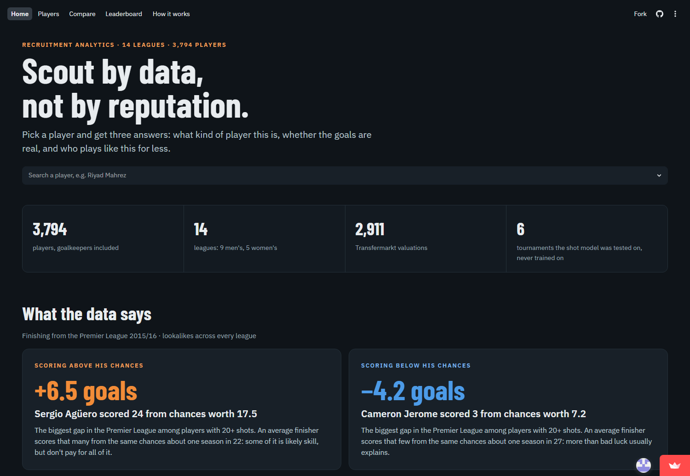
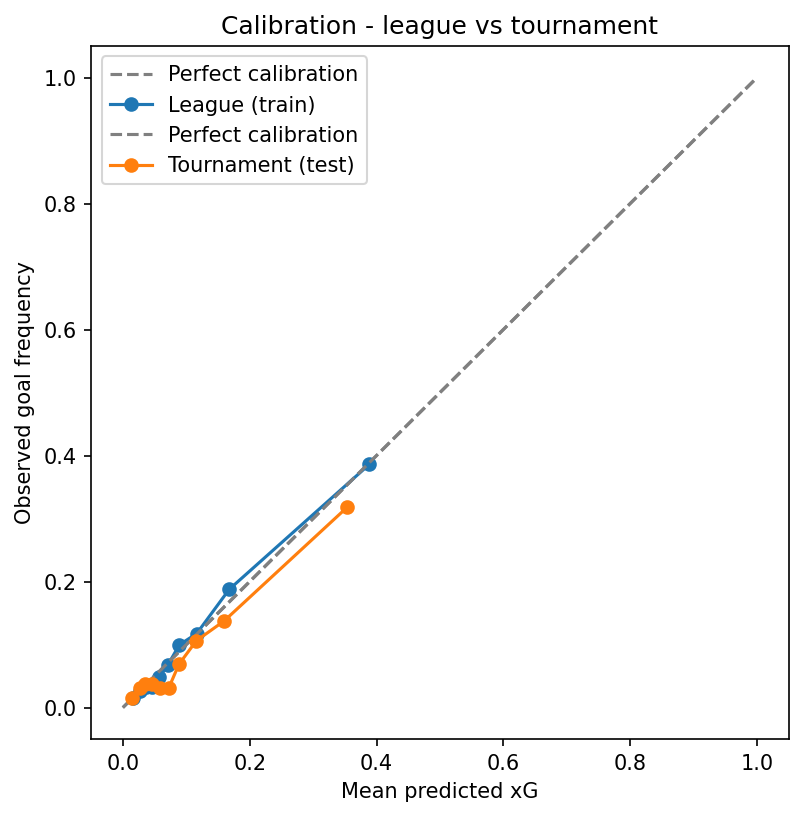
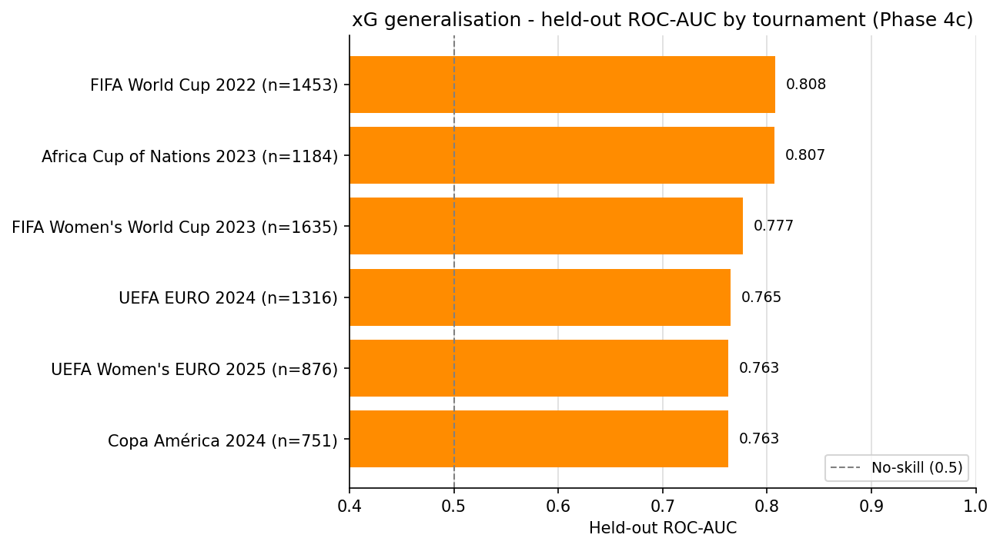
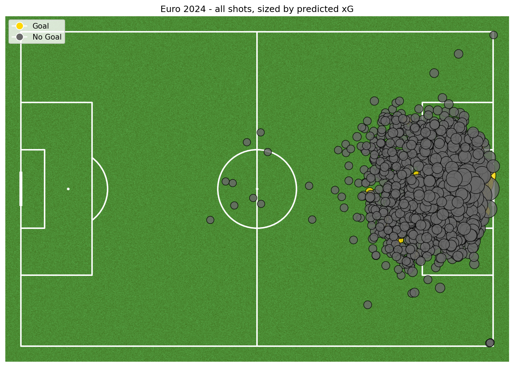
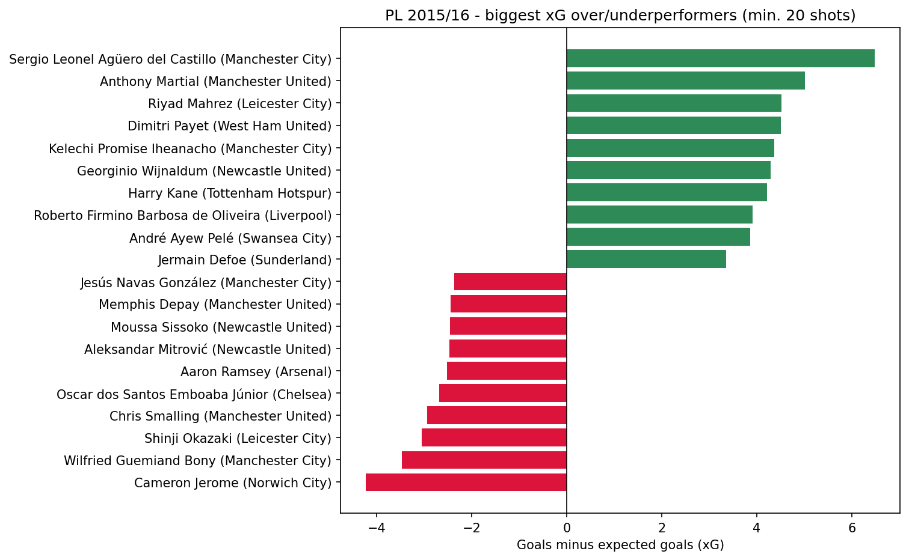
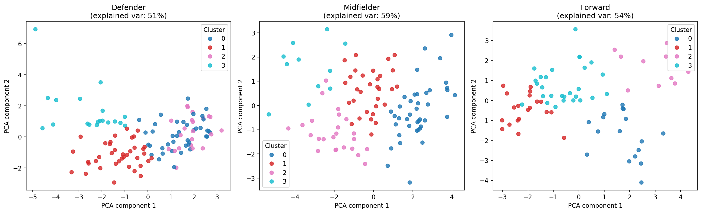
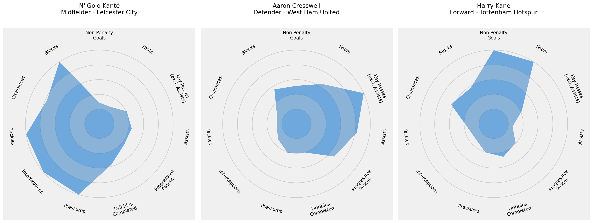

# Football Analytics Portfolio — Player Evaluation Framework

[](https://github.com/GuiPadinha/football-analytics-portfolio/actions/workflows/tests.yml)

**[Live demo](https://gpfootball-analytics-portfolio.streamlit.app)**: pick a player and get three
answers in plain words. What kind of player is this, are the goals real, and who plays like this
for less?

[](https://gpfootball-analytics-portfolio.streamlit.app)

Straight to a page:
[Riyad Mahrez, 2015/16](https://gpfootball-analytics-portfolio.streamlit.app/players?player=Riyad+Mahrez&league=Premier+League+2015/16) ·
[Mohamed Salah, 2017/18](https://gpfootball-analytics-portfolio.streamlit.app/players?player=Mohamed+Salah&league=Premier+League+2017/18) ·
[Harry Kane against Jamie Vardy](https://gpfootball-analytics-portfolio.streamlit.app/compare?player_a=Harry+Kane&player_b=Jamie+Vardy)

Built by **Guilherme Padinha**, a data engineer with a semi-professional football background,
on public StatsBomb, Wyscout and SkillCorner data. New here? [docs/FRAMEWORK.md](docs/FRAMEWORK.md)
says in one page who the tool is for and what it answers.

---

## What the app does

The player pool is **3,794 players, including 289 goalkeepers**, from 14 competitions: the Premier
League, La Liga, Serie A and Ligue 1 of 2015/16 and five women's leagues of 2023/24 (StatsBomb),
plus the five big men's leagues of 2017/18 (Wyscout). The two providers count stats differently, so
their players are never compared with each other.

- **Player page:** three questions, answered in a sentence each, then backed by the numbers.
  1. *What kind of player is this?* What he does more and less than others in his position,
     per 90 minutes, each player judged against his own league.
  2. *Are the goals real?* Goals against what the chances were worth (xG, Module A below), and the
     range of goals luck alone gives an average finisher on the same shots. Mahrez, 2015/16: 17
     goals from chances worth 12.5; an average finisher scores that many about one season in 14.
  3. *Who plays like this?* Nearest neighbours by style (Module B), men's and women's lists apart,
     next to their **Transfermarkt value** (men's competitions, ~98% matched, each at the right club).
- **Home:** findings computed from the data, not written by hand.
- **Compare:** two players side by side under a rule-based verdict. **Leaderboard:** everyone,
  sortable. **Build a player:** a labelled toy, set a style with sliders and see who plays like it.
  **How it works:** the method, the accuracy numbers and the limits.

Every sentence in the app is generated by rules from the numbers on the same page, never by an LLM.

---

## How it is built

```
StatsBomb events ─► per-match cache ─┬─► Parquet ─► dbt + DuckDB: per-90 player marts ─┐
                                     │                                                  ├─► Python: league normalisation,
                                     └─► Python: shot features ─► xG model ─────────────┤   K-means ─► app_data/ ─► app
Wyscout 2017/18 ───────────────────────► Python: per-90 ────────────────────────────────┘
```

- **SQL (dbt)** builds the StatsBomb player tables the app ships, from the raw events: minutes,
  action counts and per-90 rates for 2,170 players (below).
- **Python** owns what needs a model or a fit: the xG logistic regression with grouped
  cross-validation, league normalisation, K-means, and the Wyscout tables. `python -m
  src.pipeline` rebuilds data, models, charts and [`metrics.json`](metrics.json) headless; the
  output is byte-identical on Python 3.12 and 3.14.
- **Tests:** 300+ pytest tests, including a smoke test of every app page. Numbers quoted in the docs
  are not hand-typed: a test fails the build if this README disagrees with `metrics.json` or with
  the app's tables.

---

## Module A — Expected Goals (xG)

**Question:** given where and how a shot was taken, and what led to it, how likely was it to go in?
Goal counts reward finishing variance; xG measures the chances.

- **Train:** 10,824 shots from Bayer Leverkusen 2023/24 and the Premier League 2015/16.
- **Test:** 1,316 shots from EURO 2024, deliberately a different context (tournament football), to
  check that a league-trained model generalises rather than memorises one competition.
- **Features:** distance and angle from the real shot geometry, body part, assist type (cross,
  through ball, cut back, pass, none), first-time, under pressure, set piece, score state.

| Model | Train ROC-AUC | Test ROC-AUC (EURO 2024) | Train Brier | Test Brier |
|---|---|---|---|---|
| Logistic regression | 0.786 | **0.765** | 0.077 | **0.065** |
| Gradient boosting (tuned) | 0.796 | 0.760 | — | — |

Gradient boosting did **not** beat logistic regression, even after tuning, so the simpler model
stays: a model that's harder to explain has to earn it. Test ranking sits just below training, and
calibration is better on the tournament (Brier 0.065 against 0.077). Penalty shoot-outs are left
out: an earlier version scored 0.798 on test only because it counted them.

**Not a EURO 2024 fluke.** The same model, scored on five more tournaments it never saw:

| Tournament | ROC-AUC | Goals ÷ xG |
|---|---|---|
| FIFA World Cup 2022 | 0.808 | 1.04 |
| Africa Cup of Nations 2023 | 0.807 | 0.93 |
| FIFA Women's World Cup 2023 | 0.777 | 0.83 |
| UEFA EURO 2024 (headline test) | 0.765 | 0.84 |
| Copa América 2024 | 0.763 | 0.93 |
| UEFA Women's EURO 2025 | 0.763 | 0.98 |

The ranking holds everywhere (0.76–0.81), the women's tournaments included: a double shift, league
to tournament and men's to women's football, and still no under-prediction of women's goals.





Goals minus xG gives the over- and underperformers. Agüero, Mahrez and Kane top the Premier League
2015/16 list, which is how that season is remembered:



---

## Module B — Player similarity

**Question:** without reputation or scout notes, what type of player is this, and who else plays
the same way? The recruitment use: like-for-like replacements, cheaper alternatives, unfamiliar
leagues.

Shown here on the notebook's scope, the Premier League 2015/16 (300 players above 900 minutes);
the app runs the same method on its whole pool.
- Per-90 rates of 11 actions (non-penalty goals, shots, key passes, assists, progressive passes,
  dribbles, pressures, interceptions, tackles, clearances, blocks).
- Clustered **within each position group**: clustering everyone together mostly rediscovers
  position. A player's group is where he played the most minutes, not his most frequent slot.
- K-means with K=4 per group, PCA to draw it. Silhouette preferred K=2 and scored low everywhere:
  styles within a position are a continuum, not crisp groups. K=4 was kept for more useful
  archetypes, and the trade-off is written up in the notebook.
- "Players like X" ranks by distance, not by shared cluster.



The clusters are recognisable roles: **Kanté, Gueye, M'Vila, Tioté, Dier** (ball-winners);
**Özil, Mahrez, De Bruyne, Coutinho, Lallana** (creators who score); attacking full-backs
(**Cresswell, Bellerín**) apart from ball-playing centre-backs (**Alderweireld, Van Dijk,
Koscielny**); box finishers (**Kane, Vardy, Agüero, Giroud, Lukaku**) apart from creators and
pressing forwards.

| Target | Nearest neighbours |
|---|---|
| N'Golo Kanté | Cheick Tioté, Idrissa Gana Gueye, Jan Kirchhoff, Claudio Yacob, Jack Cork |
| Aaron Cresswell | Chris Brunt, Ben Davies, Bacary Sagna, Ryan Bertrand, Kyle Naughton |
| Harry Kane | Odion Ighalo, Jamie Vardy, Olivier Giroud, Diego Costa, Theo Walcott |



**The caveat worth reading: Michail Antonio.** He is the most extreme defender in the data (+6.0
standard deviations of non-penalty goals per 90). Not a mislabel: in 2015/16 he played more
minutes at right-back than on the wing. An earlier model gave him a cluster of his own; with two
more features he was absorbed into the full-backs as their farthest member. The outlier didn't go
away, the cluster label stopped showing it. A real recruitment tool should surface such cases, not
hide them.

---

## The dbt layer

`warehouse/` is a dbt project on DuckDB that builds the app's StatsBomb player tables from the raw
events, in SQL, after proving them equal to the pandas tables they replaced. **[Browse the dbt docs](https://guipadinha.github.io/football-analytics-portfolio/)**: every model, test
and column, and the lineage graph from the raw events to the app.

- **Raw:** `python -m src.landing --all` lands the cached events, lineups and match sheets as
  Parquet, one file per match: 2,616 matches of nine StatsBomb leagues.
- **Staging → intermediate → marts:** events, lineup stints and match sheets are typed and
  renamed; then shot features (geometry, assist type, score state by window functions), player
  minutes, a season's position group, per-match action counts; then the per-90 tables for outfield
  players and goalkeepers, `player_xg` and `team_xg`.
- **Incremental:** `int_player_match_actions`, the model that reads every event, only adds the
  matches not yet in the table (`python -m tools.warehouse --persist`). A unique test on (match,
  team, player) is what makes appending safe: without the filter it catches every duplicate.
- **Feeds the app:** `python -m src.app_data` reads the two per-90 marts (`src/warehouse_tables.py`)
  instead of building them in pandas. The switch changed no cluster of the 3,794 players and no
  Home finding, only the last bits of the rates (at most 1.4e-14: minutes are a float sum added in
  another order). The build went from 3–5 minutes to about one.
- **42 data tests**, including **parity**: the SQL shot features equal the Python ones on 9,908
  shots, column for column, and the per-90 marts equal the app's table for all 2,170 StatsBomb
  players. Each parity test was checked against a deliberately broken model.
- **CI** runs the models over `app_data/` on every push and republishes the docs site; the raw
  layer (11 GB of source data) is local only, so on the site the raw-event models show their SQL
  and lineage but no column list. The app is declared as a dbt **exposure**, the end of the graph.

What the club table says: Leicester won the 2015/16 title scoring 67 from chances worth 67.9.
Their finishing was ordinary; they made the chances. Arsenal scored 8.3 fewer than theirs were
worth, West Brom 11.1 fewer.

Still in Python, by design: the xG model (it needs scikit-learn's grouped folds), league
normalisation and clustering. SQL builds features and aggregates; Python scores.

---

## Data sources, and why two of them never meet

StatsBomb (events: passes, shots, pressures) says *what* a player did; SkillCorner (broadcast
tracking: speed, sprints) says how demanding it was. The two public samples share no player and
no match, so they are shown apart. Fusing them per player needs a club's own data, where both
exist for the same squad.

---

## Running it

Python 3.12 or 3.14 (both tested in CI; the live app runs on 3.14).

```bash
pip install -r requirements.txt        # the app alone
streamlit run app.py                   # app_data/ is committed, so this works straight away

pip install -r requirements-dev.txt    # + ingestion, notebooks, pipeline, tests
python -m src.pipeline                 # rebuild data, models, charts, metrics.json
pytest

pip install -r requirements-warehouse.txt
python -m src.landing --all            # land the cached events as Parquet (~12 min, 800 MB)
python -m tools.warehouse              # dbt build: every model and test, in memory
python -m tools.warehouse --persist    # the same into a DuckDB file, which the app build reads
python -m src.app_data                 # rebuild the app's tables from it (~1 min)
python -m src.app_data --from-pandas   # ...or without the warehouse, the StatsBomb tables by pandas
```

No API key: `statsbombpy` downloads StatsBomb's open data directly. Downloaded matches are cached
in `data/cache/` (~11 GB for everything); set `FAP_CACHE_DIR` to keep them elsewhere, e.g. outside
a cloud-synced folder. The notebooks (`notebooks/01–03`) narrate the decisions; the pipeline is
their headless twin.

## Repository

```
app.py + views/        the Streamlit app, one script per page
src/                   ingestion, features, models, similarity, charts, pipeline
warehouse/             dbt + DuckDB: staging, intermediate, marts, parity tests
tools/                 dbt runner, headless screenshots of the live app
notebooks/             01 exploration · 02 xG model · 03 player similarity
tests/                 pytest, incl. a smoke test of every app page
app_data/              the tables the app reads (committed, small)
outputs/               the charts in this README (written by the pipeline)
metrics.json           every headline number, generated; docs are tested against it
docs/                  see below
```

| Doc | What's in it |
|---|---|
| [FRAMEWORK.md](docs/FRAMEWORK.md) | What the tool is for, who uses it |
| [ROADMAP.md](docs/ROADMAP.md) | Phases, what's next |
| [MODULES.md](docs/MODULES.md) · [DATA.md](docs/DATA.md) | Model specs and results · data sources and caveats |
| [ARCHITECTURE.md](docs/ARCHITECTURE.md) · [PRODUCT_SPEC.md](docs/PRODUCT_SPEC.md) | How the code fits together · how the app is built |
| [ML_LEARNING_LOG.md](docs/ML_LEARNING_LOG.md) · [ML_THEORY.md](docs/ML_THEORY.md) | Decisions and gotchas · the theory behind them |
| [PROGRESS.md](docs/PROGRESS.md) | Session log |

**Stack:** Python · pandas · scikit-learn · `statsbombpy` · `kloppy` · `mplsoccer` · Streamlit +
Altair · dbt + DuckDB · GitHub Actions.

## What's next

- **Finishing skill, said honestly.** Pooled over 17 La Liga seasons (`src/finishing.py`), players
  do differ in finishing, but a forward test (fit on past seasons, predict the next) shows only a
  small gain, and it vanishes without Messi. Next: publish that result in the app and add more
  leagues before ranking anyone.
- **More data and models:** StatsBomb 360 freeze frames (defender positions at each shot) for a
  360-context xG and post-shot xG; current-season men's shots via Understat.
- **Module C, performance under pressure:** scoped in `docs/MODULES.md`, not started.

Full plan: [docs/ROADMAP.md](docs/ROADMAP.md).

---

## Data and licence

The code is under the [MIT licence](LICENSE). The data is not mine and keeps its own terms:

- **Events:** [StatsBomb Open Data](https://github.com/statsbomb/open-data), free for research
  with StatsBomb credited as the source.
- **2017/18 events:** Wyscout's public data set, from Pappalardo et al., "A public data set of
  spatio-temporal match events in soccer competitions", *Scientific Data* 6, 236 (2019), CC BY 4.0.
- **Tracking sample:** [SkillCorner Open Data](https://github.com/SkillCorner/opendata).
- **Market values:** Transfermarkt, through the open
  [transfermarkt-datasets](https://github.com/dcaribou/transfermarkt-datasets) mirror.

Details and caveats for each source are in [docs/DATA.md](docs/DATA.md).
